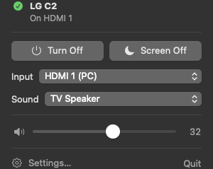
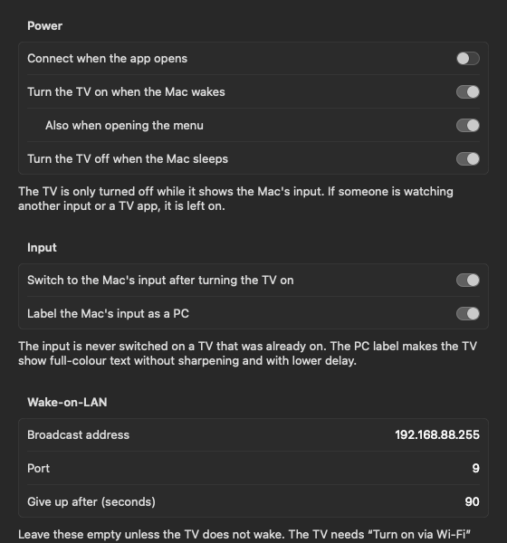
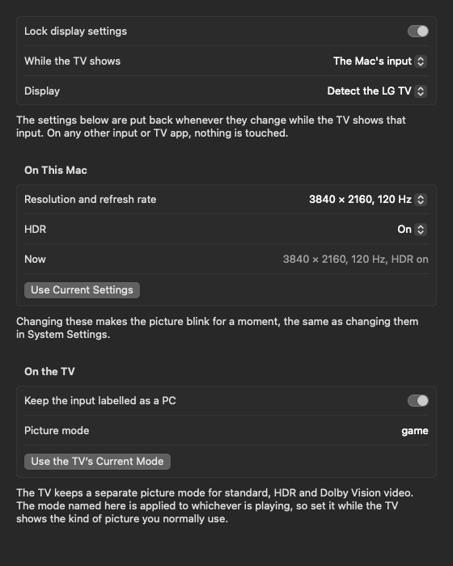

<h1>
   LGTVMenuBar
</h1>

A native macOS menu bar app for controlling LG webOS TVs.

If my LGTV Menubar app is useful to you, you can support its development.

<a href="https://ko-fi.com/sammykins/tip"></a>

## Screenshots

| Menu | Automation | Display Lock |
| --- | --- | --- |
| <a href="images/menu.png"></a><br><sub>Power, input, sound and volume</sub> | <a href="images/settings-automation.png"></a><br><sub>What happens when the Mac sleeps and wakes</sub> | <a href="images/settings-display.png"></a><br><sub>Hold resolution, refresh rate, HDR and picture mode</sub> |

## Features

- **Power with your Mac**: turns the TV on when the Mac wakes and off when it sleeps. A TV showing another input or a streaming app is left alone.
- **Display Lock**: holds the Mac's resolution, refresh rate and HDR, and optionally the TV's PC input label and picture mode, while the TV shows the Mac's input.
- **Menu bar controls**: power, screen off, input, sound output and a volume slider weighted towards the quiet end.
- **Volume keys**: use the keyboard's volume keys for the TV.
- **Stays connected**: reconnects by itself after the TV or network drops, without waking the TV.
- **Cannot loop**: automation that repeats too often pauses itself and tells you.
- **Rooted TVs (optional)**: SSH or Telnet to a TV rooted with Homebrew Channel, with the key kept in the Keychain, for settings the normal connection cannot change.
- **Newer webOS**: secure `wss://<tv>:3001` first, falling back to `ws://<tv>:3000`.
- **Signed updates**: Sparkle 2 with signed GitHub release appcasts.
- **Arylic routing**: send volume to an Arylic device in Arylic-enabled builds.

## Requirements

- macOS 15.0+
- LG webOS TV (2018 or newer recommended)
- TV and Mac on the same network
- Accessibility permission for keyboard media key capture

## Building

```bash
# Build the project
swift build

# Run tests
swift test

# Build and verify the non-menu bar UX validation app
./script/build_and_run.sh --verify

# Build a development DMG (ad-hoc signed)
./scripts/build-dmg.sh

# Build a local signed release without notarization
./scripts/build-dmg.sh --local-release

# Build a signed and notarized release
./scripts/build-dmg.sh --release

# Generate a signed Sparkle appcast after building a release DMG
./scripts/generate-appcast.sh

# Build a local/private app with Sparkle updater metadata removed
./scripts/build-dmg.sh --disable-updater
```

Notes:
- `./scripts/build-dmg.sh` produces an ad-hoc signed development build.
- `./scripts/build-dmg.sh --local-release` requires a local `Developer ID Application` certificate.
- `./scripts/build-dmg.sh --release` requires a local `Developer ID Application` certificate plus App Store Connect notary credentials.
- `./scripts/generate-appcast.sh` requires the Sparkle EdDSA private key from `SPARKLE_ED_PRIVATE_KEY`, `SPARKLE_PRIVATE_KEY_FILE`, or the local Keychain account.
- `./scripts/build-dmg.sh --disable-updater` removes `SUFeedURL`, `SUPublicEDKey`, `SUEnableAutomaticChecks`, and `SUAutomaticallyUpdate` from the staged app bundle.
- The DMG layout uses `scripts/assets/dmg-background.png` and positions the app next to an Applications symlink for drag-and-drop installation.
- `./script/build_and_run.sh --snapshots` renders the menu and every Settings pane to `screenshots/snapshots/`.

## Installation

1. Download the latest DMG from Releases
2. Open the DMG and drag LGTVMenuBar to Applications
3. Launch LGTVMenuBar
4. Follow the onboarding wizard to connect your TV
5. Grant Accessibility permission when prompted (for media key capture)
6. Use Settings › General to check for signed GitHub releases

## First Launch And Security

Official GitHub releases are `Developer ID` signed and notarized, so Gatekeeper should allow a normal first launch after you drag the app into `Applications`.

Official releases include Sparkle update metadata and can check the signed GitHub release appcast. Local/private builds made with `./scripts/build-dmg.sh --disable-updater` remove that metadata so they do not self-update.

If you build the app locally with the default `./scripts/build-dmg.sh`, the output is only ad-hoc signed for development. That build is not notarized, and macOS may treat it differently from the official release artifacts.

For local ad-hoc builds:

1. Re-grant Accessibility permission after each rebuild.
2. If Gatekeeper still blocks the app, open the bundle from Finder once with **Open** to confirm the local build.

## Setup

On first launch the app asks for the TV's name, IP address and MAC address (both are under
Network in the TV's settings), then connects. The TV shows a prompt; accept it with the remote.
Give the TV a fixed IP address on your router so it does not change.

Everything else is in Settings, opened from the menu or with Command-comma:

- **TV**: addresses, which input the Mac is plugged into, connection status.
- **Automation**: power and input behaviour, Wake-on-LAN options.
- **Display**: Display Lock.
- **Panel Care**: when the last pixel refresh ran, use since then, when the next is due, and making room for it while the Mac is locked or asleep, optionally only during set hours (rooted TVs).
- **General**: open at login, volume keys, updates.
- **Advanced**: rooted TV access and the diagnostic log.

### Rooted TVs

Root access is optional and off by default. With a TV rooted through Homebrew Channel and its SSH
server enabled, turn on **My TV is rooted** in Advanced, enter the TV's shell password once
(Homebrew Channel's default is `alpine`) and choose **Create Key and Install on TV**. The app
keeps its private key in the Keychain and remembers the TV's host key. Telnet is offered for TVs
that only expose that, but it is unencrypted and has no password.

## Development

See [AGENTS.md](AGENTS.md) for commands and rules, [docs/ARCHITECTURE.md](docs/ARCHITECTURE.md)
for how the pieces fit, [docs/HARDWARE-VALIDATION.md](docs/HARDWARE-VALIDATION.md) for what still
needs checking on a real TV, and [docs/RELEASING.md](docs/RELEASING.md) for packaging.

## License

MIT License - see [LICENSE](LICENSE) for details.
